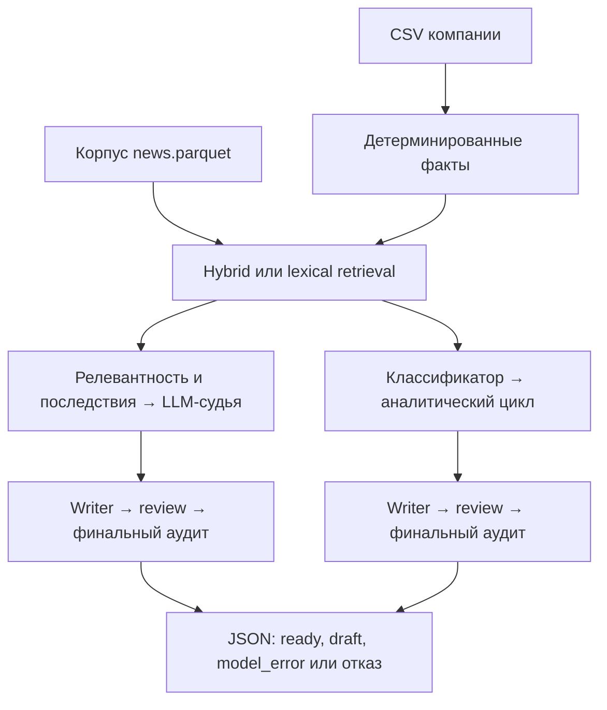

# MVP: reference для команды и обзор интеграционного PR

> Историческое описание интеграции. В текущем CLI/API движок `loop` отключён, его исходники сохранены. OCR, графики и таблицы подключены к judge; актуальные команды — в [README](../README.md) и [API](API.md).

Документ описывает рабочее дерево ветки `mvp` поверх `0712300`: новые модули Вовы из PR #10/#11 объединены
с работающими контрактами `mvp` из проверенного `repo-backup.bundle` (снимок `78ecef6`). Сохранены фикс обработки
ответов LLM (`fde7c37`), публикационные проверки, единицы и масштаб величин. Это описание реализации и её ограничений,
а не гарантия качества инсайтов. Для новых изменений сверять контракты с указанными файлами.

## Что вошло в интеграцию

| Изменение | Поведение сейчас | Основные файлы |
|---|---|---|
| Общий поиск | Оба движка используют один диспетчер `hybrid` / `lexical` | [`pipeline.py`](../pipeline.py), [`retrieval.py`](../stage3_news_search/retrieval.py) |
| События → новости | Найденное событие передаётся дальше как исходная новость-представитель с метаданными события | [`retrieval.py`](../stage3_news_search/retrieval.py) |
| Подготовка событий | `events.parquet` создаётся и пересобирается при несовпадении версии корпуса | [`events.py`](../stage4_news_relevance/plausibility/events.py) |
| Согласованность данных | Снимки корпуса, проверка векторов, миграция ссылок по URL и содержимому | [`news_corpus.py`](../common/news_corpus.py), [`embed.py`](../common/embed.py) |
| Даты сборщика | Смешанные форматы дат разбираются независимо, с приоритетом даты страницы | [`build.py`](../stage1_news_pool/web_scraping/build.py) |
| Проверка величин | Учитываются единицы, масштаб и знак; «1 млн» не подтверждает «1 млрд» | [`quantities.py`](../common/quantities.py), [`audit.py`](../stage5_insight_detection/analyst_loop/audit.py) |
| Изменение показателя | «Снизилась до 8%» — конечный уровень, не изменение −8% | [`library.py`](../stage5_insight_detection/bank_analytics/library.py), [`impact.py`](../stage5_insight_detection/analyst_loop/impact.py) |
| Проверка выдачи | Отрицательный review и серьёзные замечания финального аудита блокируют оба движка | [`pipeline.py`](../pipeline.py), [`loop.py`](../stage5_insight_detection/analyst_loop/loop.py) |
| Сбои формата LLM | Повторная попытка; после исчерпания — ошибка отдельной новости, продолжение пачки | [`models.py`](../common/llm/models.py), [`judge.py`](../stage5_insight_detection/insight_judge/judge.py) |
| Правдоподобие | В `judge` значение `0` остаётся нулём; `0.5` используется только при `None` | [`pipeline.py`](../pipeline.py) |
| OCR после слияния | Восстановлен рендеринг страниц, сохранены кеш, бюджет, повтор/пропуск страниц, полный OCR и отдельная обработка графиков | [`ocr.py`](../stage5_insight_detection/bank_analytics/ocr.py), [`charts.py`](../stage5_insight_detection/bank_analytics/charts.py) |
| Новый анализ PDF | Таблицы и графики — отдельные фрагменты, выжимки — с проверкой по страницам, optional reviewer — с возвратом к подбору кода | [`library.py`](../stage5_insight_detection/bank_analytics/library.py), [`digest.py`](../stage5_insight_detection/bank_analytics/digest.py), [`review.py`](../stage5_insight_detection/bank_analytics/review.py) |

## Подготовка окружения и запуск

Установка зависимостей, расположение таблиц и ключа описаны в [главном README](../README.md#запуск).
Для запуска нужны три CSV кейса и `data/news/news.parquet`; для использования аналитики — подготовленные материалы Банка.
`LLM_API_KEY` — ключ команды к прокси организаторов. Langfuse отвечает за наблюдение за вызовами, а не за доступ к моделям.

Из корня репозитория, в активированном окружении:

```powershell
# Аналитический цикл; локальный энкодер не загружается.
python -X utf8 pipeline.py U_68622 --role ceo --candidates 8 --judge 1 --engine loop --retrieval lexical

# Тот же движок с гибридным поиском; первый запуск может скачать веса FRIDA.
python -X utf8 pipeline.py U_68622 --role cfo --candidates 30 --judge 5 --engine loop --retrieval hybrid

# Режим LLM-судьи с инструментами.
python -X utf8 pipeline.py U_68622 --role cfo --candidates 8 --judge 1 --engine judge --retrieval lexical
```

| Аргумент | Значение по умолчанию | Что ограничивает / выбирает |
|---|---|---|
| `company_id` | Обязательный аргумент | ID компании из локальных таблиц |
| `--role` | `cfo` | Роль читателя; классификатор `loop` знает `owner`, `ceo`, `cfo`, `accountant`, `treasury` |
| `--candidates` | `30` | Бюджет shortlist; в hybrid — число событий, в lexical — строк новостей до дополнительной дедупликации |
| `--judge` | `5` | Максимум кандидатов для глубокого разбора; отказ или ошибка не заменяются следующим кандидатом сверх этого бюджета |
| `--engine` | `judge` | LLM-судья или аналитический цикл |
| `--retrieval` | `hybrid` | FRIDA + TF-IDF либо поиск по словам/граням компании |
| `--ocr` | Выключен | Перед запуском явно распознать недостающие страницы и пересобрать библиотеку |
| `--bank-charts` | Выключен | Только loop: полный OCR и проверка/оцифровка графиков |
| `--bank-tables` | Выключен | Только loop: полный OCR и сверка таблиц Gemma/Qwen/Tesseract |
| `--bank-digest` | Выключен | Только loop: полный OCR, Markdown и проверенные выжимки отчётов |
| `--bank-prepare` | Выключен | Только loop: все три этапа выше вместе с полным OCR |
| `--ocr-budget` | `15` при bank-подготовке | Бюджет OCR на этот запуск, ₽; с отдельным `--ocr` без этого параметра лимита нет |
| `--charts-budget` / `--tables-budget` / `--digest-budget` | `8` / `7` / `3` | Бюджет соответствующего включённого этапа на запуск, ₽ |
| `--bank-review` | Выключен | Только loop: дополнительно проверить выбранные банковские фрагменты агентом |
| `--bank-budget` | Без ограничения | Бюджет reviewer в рублях; применяется только вместе с `--bank-review` |

`pipeline.py` читает уже собранный корпус. Он не запускает загрузку свежих статей из интернета.
OCR включается через `--ocr` или любой из новых флагов подготовки Банка; без них платная подготовка PDF не запускается.
Параметры `--feedback`, `user_id` и интерактивное обсуждение в текущем CLI отсутствуют.

## Как проходит обработка

Общая часть: CSV компании → детерминированные факты → поиск кандидатов → отдельный движок анализа → сохранение JSON.
`research_agent`, HyDE и экспериментальные фабрики запросов существуют отдельно; обычный CLI не запускает их автоматически.



Диаграмма показывает основной путь; отказ или ошибка могут завершить обработку раньше writer.

### `--engine judge`

1. `InsightPipeline.run()` строит факты через `deterministic_facts.build()`.
2. `retrieval.candidates()` получает shortlist по выбранному методу.
3. Для каждого кандидата дешёвая модель оценивает релевантность и извлекает последствия; код получает правдоподобие события.
4. Приоритет = `relevance.score × plausibility`, где неизвестная оценка (`None`) заменяется на `0.5`.
5. До `--judge` кандидатов с положительным приоритетом получает `InsightJudge`: LangGraph-цикл с инструментами поиска
   связанных новостей, аналитики Банка и фактов компании. Итог — `InsightDecision` через финальный инструмент `decide`.
6. Только положительное решение отправляется в `InsightWriter`: текст → review → при необходимости одно исправление и новый review.
7. Отрицательный review оставляет `draft`. Положительный результат проходит общий финальный аудит чисел, ссылок и слоёв.

В `judge` нет детерминированного расчёта последствий из `loop`, но проверки текста перед публикацией общие.

### `--engine loop`

1. Загружаются профиль `CompanyProfile`, факты компании и shortlist.
2. В lexical выполняется дополнительная дедупликация. В hybrid событие уже представлено одной исходной новостью.
3. `NewsClassifier` оценивает важность, категорию, тональность и затронутые роли; факты новости берутся из корпуса по индексу.
4. Подходящие роли сортируются по важности; если фильтр ролей оказался пустым, текущий код возвращается ко всему списку оценок.
5. Для каждого из первых `--judge` кандидатов `AnalystLoop.run()` выполняет:
   карточка события → подбор банковских фрагментов → связанные новости → расчёт последствий → риски → проверка оснований.
6. При достаточных основаниях LLM объясняет расчёты и может запросить дополнительные данные.
   `RequestBroker` обращается к аналитике, новостям и фактам компании; максимум 6 обработанных запросов и 3 прохода цикла.
   Незакрытые запросы сохраняются в `open_requests`; блокирующие препятствуют выдаче.
7. `decide()` кодом формирует отказ или `InsightBrief`. Writer формулирует текст и выполняет review.
8. Финальный аудит кодом проверяет ссылки, числа и слои ответа. Серьёзные ошибки оставляют черновик.
9. Для каждого результата, включая отказ или ошибку модели, создаётся HTML-карточка.

Знак, оценки величин и уровни последствий рассчитываются правилами, а не LLM. Предположения о долге, ликвидности
и доле затрат помечаются гипотезами: они не становятся фактическими данными о компании.

## Какие модели и где вызываются

Значения по умолчанию из [`common/config.py`](../common/config.py):

| Задача | Модель / настройка | Где используется |
|---|---|---|
| Массовые оценки | Gemma, `CHEAP_MODEL=google/gemma-4-26b-a4b-it` | Релевантность, последствия; классификатор `loop` |
| Анализ и текст | GLM, `AGENT_MODEL=z-ai/glm-5.3-flash` | Судья, объяснение расчётов, writer и checker |
| Чтение сканов | Qwen VL, `VISION_MODEL=qwen/qwen3-vl-30b-a3b-instruct` | OCR текста и координат рисунков |
| Чтение вырезанных графиков и таблиц | Gemma / Qwen по параметрам standalone-скриптов | `charts.py`, `tables.py`; подтверждение и измерение выполняет код |
| Смысловой поиск | Локальный `ai-forever/FRIDA`, настройка `ENCODER_MODEL` | Только hybrid retrieval |

Модели генерации работают через LLM-прокси; FRIDA — через локальный `SentenceTransformer` на CUDA или CPU.
Допустимость FRIDA по регламенту требует подтверждения организаторов; lexical не загружает энкодер.

В `loop` классификатор получает до 25 новостей на запрос и лимит 1500 выходных токенов; пропуски переспрашиваются до 3 раз,
затем неоценённая новость исключается с записью `classify_dropped`. GLM везде работает со стандартным рассуждением
(без `reasoning_effort`); фабрика `ChatModels` по умолчанию задаёт 64000 токенов (16000 обрезали ответы писателя инсайта).
Лимит включает reasoning там, где модель его учитывает; пустой ответ не доказывает исчерпание дневного бюджета.

Количество вызовов не фиксировано: на него влияют кеш, классификация пачками, инструменты судьи, повтор разбора и review.

## Контракты между модулями

| Граница | Контракт | Что сохранять при доработке |
|---|---|---|
| Этап 2 → поиск | Список фактов с `cat`, `text`, `depth`, при наличии — `entities` | Категории и глубину; не заменять факты одной строкой без адаптера |
| Этап 1 → остальные | Строки корпуса: `id`, `title`, `text`, `date`, `source`, `url`, `tier` | Исходный текст, ссылку, дату и идентичность статьи |
| Hybrid → этапы 4–6 | Исходная новость + `event_id`, `event_news_ids`, `sources`, `urls`, `generators`, `best_rank` | `id` — ID новости, не ID события; метаданные нужны для объяснения поиска |
| Цикл → writer | `InsightBrief` и `BriefEvidence` | Разрешённые ссылки, вычисленные факты, формулы и гипотезы |
| Writer → выдача | [`Insight` и `Review`](../stage6_insight_generation/insight_writer/insight.py) | Слои фактов, позиции Банка, AI, рисков, возможностей и гипотез |
| Пайплайн → хранение | Список результатов + `corpus_fingerprint`, `news_references` | Сохранять через `save_results()`, читать с проверкой версии источников |

Ссылки имеют вид `news:<id>`, `bank:<report>:<page>` в judge; в loop — `bank:<file>:p<page>.<fragment>`.
Факты judge используют `fact:<номер>`, loop — именованные `fact:<slug>` и `fact:stage2_<номер>`.
UI должен разрешать ссылки по данным результата, а не пытаться угадать единый формат разбором строки.

Новые ID сборщика — 63-битные числа из хеша URL. В Python они точные; при проектировании JSON API для JavaScript
сериализовать ID строками до `JSON.parse`, чтобы не потерять точность `Number`. Текущие результаты могут содержать
числовые и строковые ID; полного API, нормализующего их для frontend, пока нет.

## Выдача, статусы и ошибки

Основной файл: `data/insights/<company_id>_<role>.json`, корень — JSON-массив результатов.
Повторный запуск той же пары заменяет этот файл. `loop` дополнительно пишет `data/insights/cards/`.

| Состояние | Поля | Как использовать |
|---|---|---|
| Готов | `status="ready"`, `insight`, `review` | Можно показывать как готовый инсайт |
| Review отклонил текст | `status="review_rejected"`, `draft`, `review` | Черновик для диагностики; готового `insight` нет |
| Аудит отклонил текст | `status="audit_rejected"`, `draft`, `audit` | В обоих движках; положительный review не отменяет финальный аудит |
| Ошибка структуры LLM | `status="model_error"`, `error` | Поля `stage`, `schema`, `attempts`, `message`; остальные новости продолжают обрабатываться |
| Обычный отказ | В loop: `verdict.status="reject"`; в judge: `decision.is_insight=False` | Верхний `status` может отсутствовать; готового `insight` нет |

Для выдачи фильтровать явно:

```python
from common.data import DATA
from common.news_corpus import load_results
from common.search import news_pool

results = load_results(DATA / "insights" / "U_68622_ceo.json", news_pool())
ready = [r for r in results if r.get("status") == "ready" and r.get("insight")]
```

`review.ok` сам по себе не является разрешением на публикацию. Количество результатов в JSON также не равно числу инсайтов.
Блокирующие замечания аудита: `foreign_number`, `unknown_ref`, `no_source`. `no_number`, перенос позиции в AI
и удаление неподходящего банковского продукта сохраняются как предупреждения, сами по себе они не блокируют выдачу.
Аудит также проверяет числа в `title` и `ai_conclusion`. Допуск «≈» / «около» относится к следующему числу,
а не ко всем значениям в утверждении. Оси графика и числа в описании модели не подтверждают значение ряда.
Неизвестные ссылки в отклонённом ответе сохраняются как `unresolved_news_ids`, отдельно от проверенных
`news_references`; это позволяет сохранить черновик и продолжить пачку. Такой ответ нельзя перевести в `ready`,
оставив неразрешённые ссылки. Основная новость всегда должна существовать в исходном снимке.

`structured()` возвращает валидную Pydantic-модель либо выбрасывает `StructuredOutputError` после 2 попыток.
Повтор содержит уточнение запроса и другой ключ кеша: некорректный сохранённый ответ не воспроизводится тем же запросом.
Судья отдельно повторяет цикл при некорректном или отсутствующем `decide`.
Это изоляция ошибок формата; произвольные программные, файловые и сетевые ошибки не превращаются автоматически в `model_error`.

## Аналитика Банка и OCR

PDF кладутся в `data/analytics/`; метаданные известных отчётов — в [`reports.json`](../stage5_insight_detection/bank_analytics/reports.json).
Если текстового слоя нет, для использования аналитики нужен OCR. Команды с OCR обращаются к платному LLM API.

```powershell
# Подготовить фрагменты новых/изменённых PDF; использовать текстовый слой или уже существующий OCR.
python -X utf8 stage5_insight_detection/bank_analytics/library.py

# Для новых/изменённых PDF разрешить распознавание страниц без текстового слоя.
python -X utf8 stage5_insight_detection/bank_analytics/library.py --ocr

# Распознать конкретный файл из data/analytics/.
python -X utf8 stage5_insight_detection/bank_analytics/ocr.py "report.pdf"

# Проверить поиск по подготовленным фрагментам.
python -X utf8 stage5_insight_detection/bank_analytics/library.py --search "ключевая ставка прогноз"
```

Выход: `ocr/<имя>.jsonl` с текстом по страницам, `fragments.jsonl` с фрагментами и `registry.json` с хешами PDF.
OCR читает страницу vision-моделью, повторяет ошибку/пустой/зацикленный/обрезанный ответ и кеширует успешный текст.
Прогресс OCR содержит имя PDF, страницу `pN/total` и попытку `1/2` или `2/2`, затем `OK`, `retrying` либо `skipped`.
Счётчик попыток начинается заново на каждой странице; две строки `attempt 1` могут относиться к разным страницам.
Для пустого ответа и циклических повторов печатаются разные причины; содержимое страниц в консоль не выводится.
Полный OCR, графики, таблицы и выжимки включаются флагами общего запуска либо отдельными скриптами;
цифры, прочитанные моделью, не равны подтверждённым величинам.

Чтобы пройти подготовку и агентский цикл одной командой:

```powershell
python -X utf8 pipeline.py U_68622 --role ceo --candidates 8 --judge 1 --engine loop --retrieval lexical --bank-prepare

# Только графики и таблицы, с необходимым полным OCR и своими бюджетами.
python -X utf8 pipeline.py U_68622 --role ceo --engine loop --retrieval lexical --bank-charts --bank-tables --ocr-budget 15 --charts-budget 8 --tables-budget 7

# Только выжимки; неизменившиеся выжимки берутся из кеша.
python -X utf8 pipeline.py U_68622 --role ceo --engine loop --retrieval lexical --bank-digest --digest-budget 3
```

[`prepare.py`](../stage5_insight_detection/bank_analytics/prepare.py) выполняет полный OCR недостающих страниц,
затем выбранные чтения графиков/таблиц, обновляет библиотеку и при необходимости создаёт Markdown/выжимки.
В `AnalystLoop` передаётся уже обновлённый объект библиотеки того же запуска. Цифры и ссылки графиков/таблиц
доступны объясняющей модели, writer и финальному аудиту. Дополнительный reviewer по-прежнему включается отдельно.

Подготовка общая для всего запуска, до анализа конкретных новостей. Графики/таблицы проверяются на всех страницах PDF,
включая страницы вне старого пилота и страницы, где основной OCR не заметил графика. Страницы с найденной структурой идут первыми.
Успешные страницы, кропы, таблицы и неизменившиеся выжимки кешируются; незапрошенные этапы не запускаются.
Зависимости локального OCR проверяются до платных вызовов; языковые данные автоматически не скачиваются.

Лимиты этапов независимы и не включают последующую генерацию инсайтов. При исчерпании лимита или ошибке формата
части материалов сохраняется прогресс, продолжаются остальные этапы, затем анализируется доступная аналитика.
`preparation.json`, шаги `bank_preparation_stage`/`bank_preparation` в журнале и поле `bank_preparation` результата
содержат расходы и статусы `complete`, `partial` или `empty` (PDF не найдены).

Оба движка используют `BankLibrary.refresh()` без OCR: проверяются PDF, основной/полный OCR, таблицы, графики,
метаданные и версия парсера. Удалённые PDF исключаются из библиотеки. `BankAnalytics` сохраняет прежний API поиска,
но получает материалы из общей подготовки. Чтение старого OCR без PDF поддерживается для совместимости.
В смешанном PDF текстовый слой выбирается постранично: сканы не исчезают из-за наличия текста на других страницах.
Таблицы сверки заменяют только совпавшие исходные таблицы; графики и остальные таблицы страницы сохраняются.

`pipeline.py --ocr` пересобирает библиотеку, но не заставляет vision повторно читать уже закешированные страницы.
Новые OCR-кеши получают `.source.json` с хешем PDF, промпта и настройками. При изменении входа предыдущий OCR
сохраняется в `*.previous.jsonl`, страницы распознаются заново. Графики/таблицы аналогично сохраняют старые результаты
в `previous/`; чтение производных от другого PDF блокируется. Старые кеши без происхождения поддерживаются,
но при миграции помечаются `legacy_unverified`: задним числом подтвердить соответствие PDF нельзя.
Обычное обновление не делает платных вызовов и не пересчитывает таблицы/графики моделью; для этого нужны явные команды ниже.
`--rebuild` принудительно повторяет разбор; изменения версии парсера и файлов оцифровки также вызывают обновление.

Для нового полного процесса подготовки (все команды из корня; OCR, charts, tables и digest могут вызывать платный API):

```powershell
# Один раз: языковые данные локального OCR; дальнейшее распознавание работает без сети.
python -m common.ocr_local --download

# Полный текст страниц с блоками таблиц и графиков.
python -X utf8 stage5_insight_detection/bank_analytics/ocr.py --prompt ocr_page_full --out-dir data/analytics/ocr_full --budget 15

# Выделить структуру страниц; --all у charts/tables также обновляет библиотеку перед выбором страниц.
python -X utf8 stage5_insight_detection/bank_analytics/library.py

# Читать вырезанные графики, измерить геометрию и сверить подписи.
python -X utf8 stage5_insight_detection/bank_analytics/charts.py --all --ground qwen --model gemma --budget 8

# Независимые чтения таблиц и сверка ячеек.
python -X utf8 stage5_insight_detection/bank_analytics/tables.py --all --budget 7

# Подготовить общий читаемый текст и фрагменты для анализа.
python -X utf8 stage5_insight_detection/bank_analytics/export_text.py --ocr-dir data/analytics/ocr_full --fallback-ocr-dir data/analytics/ocr
python -X utf8 stage5_insight_detection/bank_analytics/library.py --rebuild

# Выжимки отчётов: позиции Банка и цифры со ссылками на страницы.
python -X utf8 stage5_insight_detection/bank_analytics/digest.py --budget 3

# Использовать reviewer в пайплайне явно; его бюджет общий для этого запуска.
python -X utf8 pipeline.py U_68622 --role cfo --engine loop --retrieval lexical --bank-review --bank-budget 1.5
```

Без `pytesseract` / `tesseract.exe` локальные подписи распознаёт встроенный Tesseract PyMuPDF с данными
`rus+eng` из `.cache/tessdata` либо `TESSDATA_PREFIX`. Модельные числа не подтверждаются этим автоматически:
новые проверки графиков и таблиц остаются обязательными. Измеренные кодом значения допускаются только с «≈» / «около»,
при этом сохраняется старая проверка единиц, масштаба и знака.

Дополнительный поиск в цикле использует те же фильтры события, страны и эмитента, что и начальный подбор.
Цитата ЦБ не становится собственной позицией Банка. Изменения процентов не используются как исходный уровень ставки;
отчёт, опубликованный после новости, не служит базой её изменения. Доли отраслей контрагентов считаются от полного
потока платежей, включая неизвестные отрасли. После получения данных на последнем проходе основания пересчитываются.
Повторные публикации одного источника и поздние новости сами по себе не увеличивают число независимых подтверждений.

Ошибочный JSON vision повторяется с изменённым запросом и не сохраняется как «на странице нет графиков/таблиц».
Выжимки проверяют единицы и масштаб, числа в сводке и происхождение позиции Банка; устаревшая выжимка не передаётся writer.
Бюджет — превентивная оценка по уже наблюдавшейся стоимости; точная цена отдельного запроса известна после ответа API.

## Обновление новостей и зависимых файлов

Из корня репозитория:

```powershell
Push-Location stage1_news_pool/web_scraping
python -X utf8 discover.py --days 31
python -X utf8 fetch.py --tier 1
python -X utf8 build.py --days 31
Pop-Location
```

Первые две команды обращаются к сайтам; третья публикует корпус через `publish_news()`.
Подробнее об источниках и параметрах — в [README сборщика](../stage1_news_pool/web_scraping/README.md).
Скрипты сборщика используют свой путь `data/news`, поэтому при нестандартном `ALFA_DATA` пути входов и публикации
нужно согласовать отдельно: эта переменная не является общей настройкой всех standalone-скриптов.

| Файл | Жизненный цикл |
|---|---|
| `news/news.parquet` | Активный корпус; новая сборка использует ID от нормализованного URL |
| `news/events.parquet` | Производный файл; пересоздаётся при несовпадении fingerprint |
| `news/versions/<fingerprint>/news.parquet` | Неизменяемый снимок исходных материалов |
| `news/versions/<fingerprint>/emb_<model>.npz` | Векторы этого снимка; проверяются модель, fingerprint и порядок ID |
| `news/rebuild_report.json` | Миграция ID и состояние ссылок сохранённых результатов |
| `insights/*.references.json` | Проверка ссылок старых результатов после пересборки |

Новая публикация готовит события перед заменой активного корпуса. Векторы строятся лениво при следующем dense-поиске.
Сохранённые утверждения не переписываются под изменённые статьи; одного совпадения числового ID недостаточно.

```powershell
python -X utf8 common/news_corpus.py --check data/insights/U_68622_ceo.json
python -X utf8 common/news_corpus.py --history data/insights/U_68622_ceo.json
```

`load_results()` проверяет актуальность ссылок; `load_history()` возвращает исходные материалы архивного снимка.
Изменённый/удалённый источник, несовпадение fingerprint или отсутствие исходного снимка требуют явного решения вызывающего кода.
Не удалять снимки, если на них опираются нужные исторические результаты.
Метки и векторы экспериментов также связаны с корпусом: после пересборки их нужно пересоздать с привязкой,
а не подставлять старые event ID в новый корпус.

## Проверки для работы над модулями

Команды из корня репозитория, в активированном окружении. Для гарантированно локального прогона в PowerShell
отключить Langfuse в текущем процессе; скриптовые модели не обращаются к LLM API:

```powershell
$env:LANGFUSE_PUBLIC_KEY = ''
python -X utf8 -m unittest test_news_corpus test_merge_regressions test_pipeline_failures
python -X utf8 -m unittest test_bundle_integration
python -X utf8 -m unittest test_deep_integration
python -X utf8 -m unittest test_bank_preparation
python -X utf8 test_pipeline.py
python -X utf8 stage5_insight_detection/analyst_loop/test_analyst_loop.py
python -X utf8 stage5_insight_detection/bank_analytics/test_ocr.py
git diff --check
```

Unit-тесты и цикл аналитики используют синтетику и не требуют CSV кейса или энкодера.
Расширенный `test_analyst_loop.py` проверяет реальные пиксели синтетических графиков и требует языковых данных локального OCR.
`test_pipeline.py` использует локальные таблицы и корпус с подставными моделями.
`test_ocr.py` проверяет вставку описаний рисунков в текст страницы и обнаружение зацикленного текста;
это не проверка рендеринга PDF или качества настоящего vision API.

| Что меняется | Какие проверки особенно нужны |
|---|---|
| Корпус, события, embeddings, ссылки | `test_news_corpus`, `test_merge_regressions`; не скачивать энкодер ради unit-теста |
| Парсер ответа, судья, writer | `test_pipeline_failures`, `test_pipeline.py` |
| Расчёты, аудит, статусы | `test_merge_regressions`, `test_pipeline_failures`, `test_analyst_loop.py` |
| OCR и промпты | `test_ocr.py`, `test_pipeline.py`; живое качество OCR проверять отдельно |

Контрольная проверка восстановления выполнялась поверх `0712300` в Windows / Python 3.13. Актуальные результаты прогона
зафиксированы в разделе ниже. Прохождение офлайн-тестов не измеряет полноту поиска или полезность выдачи реальным моделям.

## Результаты проверки текущего состояния

- 101 unit-тест: `test_news_corpus`, `test_merge_regressions`, `test_pipeline_failures`, `test_bundle_integration`, `test_deep_integration`, `test_bank_preparation` — пройдены.
- Проверена общая цепочка OCR → график → три чтения таблицы → фрагменты → выжимка → материалы writer на синтетическом PDF;
  повторный прогон использует кеши, CLI-флаги передают подготовленную библиотеку в тот же агентский цикл.
- `test_pipeline.py` — пройден: промпты форматируются, сквозной judge-сценарий работает с подставными моделями.
- `analyst_loop/test_analyst_loop.py` — пройден: расчёты, черновик после аудита, отказы, источники и журнал.
- `bank_analytics/test_ocr.py` — пройден: объединение текста с описаниями рисунков и обнаружение повторов.
- Дополнительно прошли проверки генераторов, событий и batch-ranker.
- `loop` на настоящем локальном корпусе и таблицах с подставными LLM завершился корректным отказом и записал HTML-карточку.
- Обе настроенные LLM прошли короткий живой structured-output тест `value=7` на синтетическом запросе;
  данные кейса и PDF моделям при проверке не отправлялись. Качество полноценной выдачи реальными моделями не оценивалось.
- Синтетические графики распознаны локальным OCR; скачаны только языковые данные `rus+eng`.
  OCR реальных PDF и скачивание FRIDA при восстановлении не запускались.

## Открытые проблемы и границы MVP

| Проблема / граница | Что учитывать в своей работе |
|---|---|
| На текущей машине ещё нет OCR реальных отчётов | 9 PDF / 64 страницы состоят из сканов; `fragments.jsonl` пуст. Без явной подготовки аналитики пайплайн сможет работать только с новостями и данными компании |
| Чистая установка точных pinned-зависимостей не проверена | Тесты выполнялись в установленном Windows/Python 3.13 окружении; это не подтверждает установку всех версий из requirements на другом компьютере |
| Производные данные кейса есть в отслеживаемых экспериментах и golden set | `experiments/briefs/README.md` и `company_facts_golden.json` содержат сведения из таблиц. Перед внешней передачей заменить их синтетикой; игнорирование CSV не скрывает эти сведения |
| Нет общего серверного API и механизма обратной связи | `frontend/index.html` — самостоятельный демо-интерфейс с демоданными. В этой ветке нет связанного с пайплайном feedback API или CLI-обсуждения |
| Нет автоматического фильтра «последние 14 дней» в `run_loop()` | Функция `fresh()` существует, но общий запуск её не вызывает; актуальность корпуса задаётся подготовкой данных |
| Общий результат может быть пустым | Кандидаты могут отсеяться, классификатор — не вернуть оценки, судья или проверки — отказать. Увеличение `--judge` расширяет бюджет разбора, но не гарантирует выдачу |

Не считать задачи из этой таблицы выполненными только потому, что интеграционные тесты проходят.

## Куда подключать следующую работу

| Задача | Точка входа |
|---|---|
| Новые источники новостей | `stage1_news_pool/web_scraping/sources.py`, `discover.py`, `fetch.py`, публикация через `build.py` |
| Новый способ retrieval | Диспетчер `stage3_news_search/retrieval.py`; на выходе сохранить контракт исходной новости и provenance события |
| Новые расчёты и правила влияния | `analyst_loop/profile.py`, `impact.py`, `risks.py`; формулы и допущения передавать как `Fact` |
| Новый источник недостающих данных | `data_requests.py` и `AnalystLoop._handlers()`; ответы должны менять досье и участвовать в повторной проверке оснований |
| Изменение текста инсайта | `insight_writer/prompts/`; схему менять согласованно с writer, audit, renderer и потребителем JSON |
| API / UI / обсуждение | Читать готовые результаты с проверкой ссылок, публиковать только `ready`, сохранять строковые ID и версию источников |

Новые промпты держать рядом с использующим кодом. Литеральные фигурные скобки в шаблонах экранировать как `{{` и `}}`.
Для структурированных ответов использовать `structured()` и обработку `StructuredOutputError` на границе новости.
Кеширование результатов привязывать к содержимому, промпту и схеме, а не только к переиспользуемому числовому ID.
Для примеров, тестов и PR использовать синтетические данные; реальные таблицы, ответы моделей, логи и архивы проекта
не добавлять в Git. Изменения схем и статусов сопровождать обновлением этого документа и соответствующих тестов.
