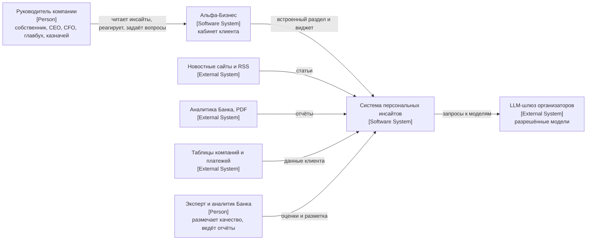
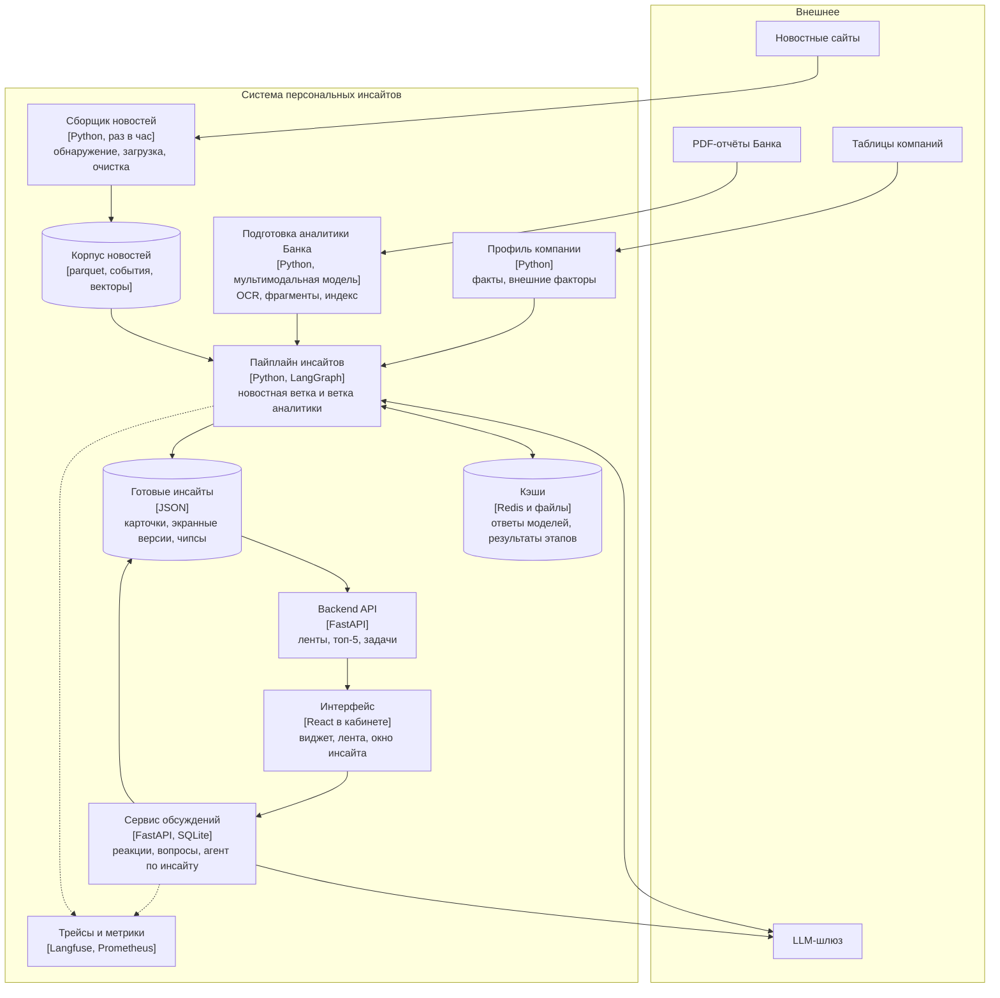
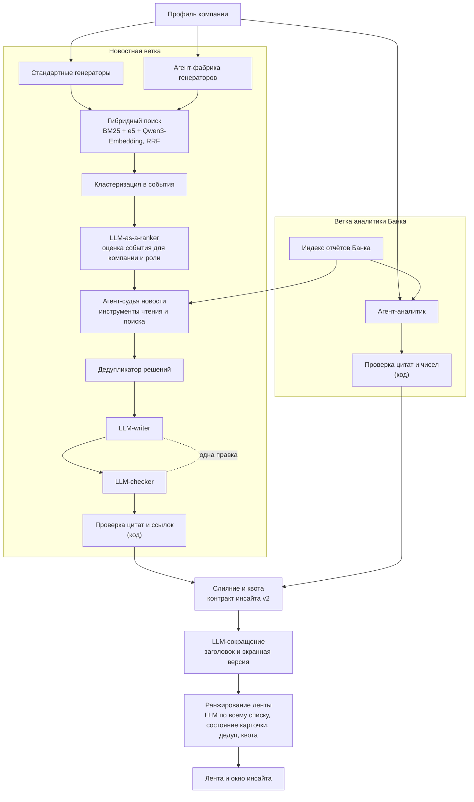
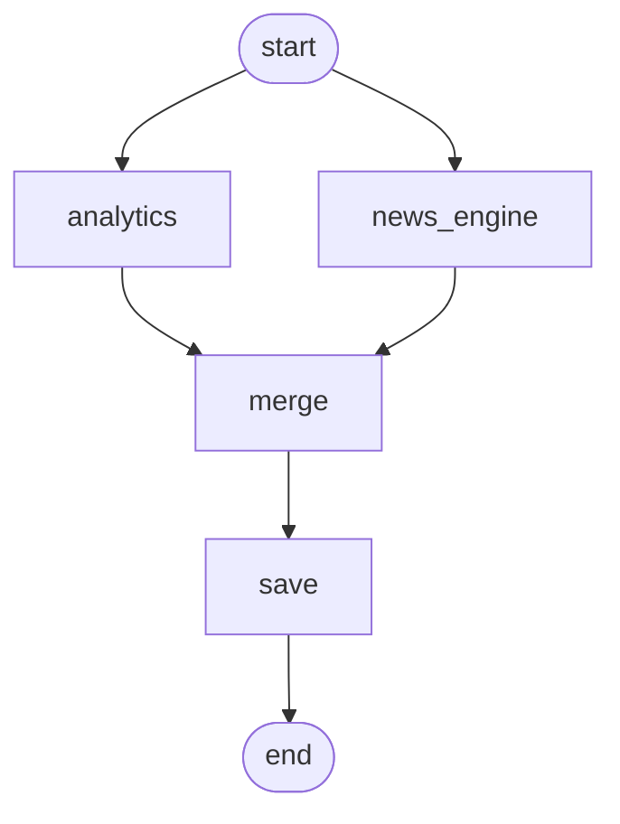

# Архитектура

Система превращает внешние новости, аналитику Банка и данные о компании в персональные инсайты для руководителя: что
произошло, почему это важно именно этой компании, какие риски и возможности, что делать, как это оценивает Банк, на чём
основан вывод. Ниже порядок обработки, затем три уровня схем C4: контекст, контейнеры, компоненты.

## 1. Как устроена обработка

1. Сбор новостей. По расписанию (в проде раз в час) сборщик находит новые адреса, скачивает статьи, очищает и объединяет с корпусом. Адреса
   нормализуются, неизменившиеся страницы пропускаются условными запросами. Статья, у которой совпал текст, не дублируется.
   Корпус публикуется атомарно, поэтому анализ всегда видит целый снимок.
2. Профиль компании. Из таблиц компании, платёжных связей и группы собирается набор проверяемых фактов и список внешних
   факторов (ставка, курс, отрасль, страны внешней торговли, регион, продукты Банка). Это единственный источник фактов о
   компании: цифры, которых нет в профиле, в инсайт не попадают.
3. Генераторы кандидатов (retrieve). Два набора генераторов превращают профиль в поисковые запросы к корпусу:
   стандартные (по одному на причину из профиля: своя отрасль, поставщики, покупатели, регион, продукт Банка, макрофактор) и
   генераторы, которые под каждую компанию собирает агент-фабрика[^1]. Поиск гибридный: BM25 и два эмбеддинг-энкодера (e5 и
   Qwen3-Embedding), результаты сливаются по рангу (RRF). Генераторам выделены квоты мест, чтобы один из них не занял весь
   список.
4. События. Новости об одном и том же собраны в события (кластеры по похожести заголовка и первых строк в окне нескольких
   дней). Кандидатом считается событие, а не отдельная статья, поэтому один сюжет не занимает несколько мест.
5. LLM-as-a-ranker. Для события оценивается представитель: насколько оно относится к этой компании и роли, оценка от 0 до 3,
   канал влияния, направление, соответствие роли. Приоритет равен оценке, умноженной на достоверность события. Отбираются
   лучшие.
6. Исследование и решение. Агент-судья новости получает событие и инструменты: другие сообщения того же события, следующие
   новости по теме, поиск по корпусу, поиск по аналитике Банка, факты компании, калькулятор. Он решает, есть ли инсайт, а не
   пересказ, и собирает материалы. Дубли решений (то же событие или тот же прогноз Банка и то же следствие) склеиваются
   до написания.
7. Писатель и проверяющий. LLM-writer пишет карточку по слоям: факты, позиция Банка, вывод AI, риски, возможности, действия.
   LLM-checker сверяет каждое утверждение с материалами. Если есть замечания, писатель делает одну правку. Затем код проверяет
   ссылки и ищет в источниках дословные цитаты. Карточка, у которой остались утверждения без источника, не попадает в ленту.
8. Параллельная ветка аналитики Банка. Пока идёт новостная ветка, отдельный агент-аналитик ищет инсайты в отчётах Банка
   без новости: находит позицию Банка, привязывает её к фактам компании и роли, цифры и цитаты проверяет кодом. Его карточки
   идут в тот же список. Отчёты Банка это сканы, поэтому до этого их распознаёт мультимодальная модель, а текст режется на
   фрагменты с поиском по странице.
9. Цитаты и источники. У каждого утверждения есть ссылки на новость, страницу отчёта Банка или факт компании, а у фактов из
   новости ещё и цитата с позицией в тексте. В интерфейсе цитата раскрывается под фактом и ведёт к источнику.
10. Заголовок и экранная версия. Отдельный вызов LLM сокращает полный инсайт до ёмкого заголовка, тезиса, коротких фактов и
    условий «особенно важно, если». Полный инсайт остаётся первоисточником, экранная версия ссылается на его элементы, а
    источники в неё подставляет код.
11. Ранжирование внутри ленты. Карточки упорядочиваются по актуальности для читателя: LLM оценивает ценность всего списка за
    один вызов, затем код применяет состояние карточки (месяц жизни, последняя неделя идёт ниже), убирает дубли и держит
    квоту новостей и аналитики Банка. Порядок меняется по ходу появления новых карточек, но результат для неизменного набора
    берётся из кэша.

## 2. C4, уровень 1: контекст системы

## 3. C4, уровень 2: контейнеры

Контейнеры Docker, которые поднимает compose: redis, cache-seed (заливает готовые ответы моделей в Redis), backend,
feedback-api, frontend (nginx, проксирует API). Пайплайн запускается внутри backend задачей на пару компания и роль либо
читается из сохранённых результатов.

## 4. C4, уровень 3: компоненты пайплайна

## 5. Граф LangGraph

Один прогон на пару компания и роль это граф LangGraph. Новостной движок и ветка аналитики стартуют параллельно и сходятся в
узле слияния, потом результат сохраняется.

Внутри news_engine свой граф: оценка кандидатов идёт параллельно (assess_one на каждое событие), узел rank выбирает лучшие,
judge_one работает параллельно по отобранным, узел gate склеивает дубли решений, write_one параллельно пишет карточки, collect
собирает результат. Обрыв связи теряет одну новость, а не прогон. Прогон возобновляется с контрольной точки.

## 6. Что гарантирует архитектура

- Слои инсайта разделены полями: факты из новостей, позиция Банка, вывод AI, гипотезы. Дисклеймеры вшиты в интерфейс.
- Утверждение без источника не публикуется: его снимает проверяющий, а затем код.
- Дорогие этапы не пересчитываются зря. Результат этапа хранится по хэшу его входов: статья и её событие, факты компании,
  роль, библиотека отчётов Банка, промпты и модель. Профиль компании и спецификация фабрики генераторов не зависят от пула
  новостей, поэтому поток новостей не запускает их заново.
- Новые новости на тике не запускают пайплайн целиком: считаются только пары событие и компания, которых ещё нет.
- Карточка живёт месяц от даты события. Дата интерфейса может быть заморожена для демо.

[^1]: Агент-фабрика генераторов. Агентом называем LLM, которая работает в цикле: вызывает инструменты, смотрит результат и
решает, что делать дальше. Здесь агент получает краткое описание компании, формулирует, как её бизнес зависит от внешних
событий (спрос, издержки, цены, регулирование, ставка, курс, логистика и других каналов влияния), пишет поисковые запросы и
проверяет каждый инструментом probe прямо на корпусе новостей: что найдено и насколько это по делу. В итоге выбирает только
проверенные запросы и отчитывается, какие каналы покрыты. Результат это набор генераторов, подогнанный под одну компанию.
Он сохраняется и дальше используется без новых вызовов модели; пересобирается только при изменении профиля, промптов или
модели.
